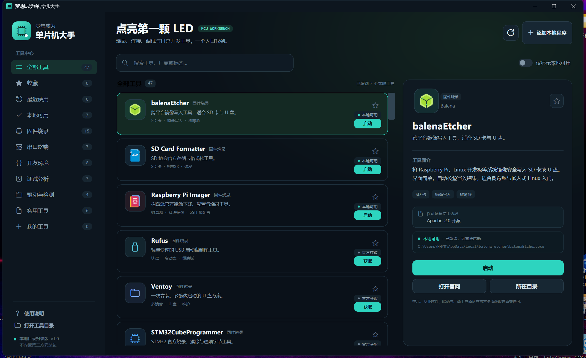

# 梦想成为单片机大手

> 单片机开发、烧录、串口与调试工具统一启动器

“梦想成为单片机大手”参考图吧工具箱的“统一入口 + 分类目录 + 软件清单 + 按需启动”思路，把固件烧录、串口/SSH、开发环境、调试分析、驱动和效率工具集中到一个 Windows 启动器中。

- Windows 10 / 11 x64
- 主程序为自包含单文件 EXE，无需另装 .NET
- 内置 47 款常用工具的中文清单与官方入口
- 自动识别安装版、绿色版和用户自定义程序
- 不包含、不转载任何第三方软件安装包



## 功能

- 固件烧录、串口终端、开发环境、调试分析、驱动与检测、实用工具六大分类
- 搜索、收藏、最近使用、仅显示本地可用、自定义工具
- 扫描 `tools` 目录、注册表 Uninstall 信息、App Paths 和用户自定义路径
- 读取本地 EXE 的真实图标与版本信息
- 对需要管理员权限的程序使用 UAC 启动
- 未安装时仅打开官方网站，不自动下载或静默安装
- `data` 目录随身保存设置，整个文件夹可移动
## 直接运行

1. 下载或克隆本仓库。
2. 保持 `梦想成为单片机大手.exe`、`catalog.json`、`tools` 和 `data` 在同一目录。
3. 双击 `梦想成为单片机大手.exe`。

首次运行可能出现 Windows SmartScreen“未知发布者”提示。这是因为程序没有商业代码签名证书；请确认文件来自本仓库后继续。

## 添加自己的软件

最简单的方式是点击右上角“添加本地程序”，选择任意 EXE。

绿色便携版也可以放入对应分类目录：

```text
tools/firmware/MyFlasher/
tools/terminal/MyTerminal/
```

然后点击“重新扫描”。

如果要显示完整的名称、厂商、官网和分类，可以在 `catalog.json` 的 `tools` 数组中增加一项。最小示例：

```json
{
  "id": "my-tool",
  "name": "我的烧录器",
  "category": "固件烧录",
  "summary": "一句话简介",
  "description": "较完整的说明",
  "vendor": "厂商名称",
  "license": "许可说明",
  "homepage": "https://example.com/",
  "downloadUrl": "https://example.com/download",
  "folder": "firmware/MyTool",
  "executableNames": ["MyTool.exe"],
  "detectNames": ["My Tool"],
  "requiresAdmin": false,
  "glyph": "\uE950",
  "accent": "#2DD4BF",
  "tags": ["烧录", "USB"]
}
```
## 内置工具

### 固件烧录（15）

balenaEtcher、SD Card Formatter、Raspberry Pi Imager、Rufus、Ventoy、STM32CubeProgrammer、ESP Flash Download Tool、esptool、pyOCD、OpenOCD、SEGGER J-Link、TI UniFlash、nRF Connect for Desktop、WCHISPTool、Flash Magic。

### 串口终端 / SSH（7）

Xshell 8、PuTTY、Tera Term、MobaXterm、Windows Terminal、WinSCP、Serial Studio。

### 开发环境（8）

Arduino IDE、Visual Studio Code、STM32CubeIDE、Keil MDK、IAR Embedded Workbench for Arm、ESP-IDF、PlatformIO、Thonny。

### 调试分析（7）

Wireshark、Saleae Logic 2、PulseView、HxD、USBTreeView、MQTTX、SEGGER Ozone。

### 驱动与检测（4）

Zadig、WCH CH341SER 驱动、Silicon Labs CP210x VCP 驱动、FTDI VCP 驱动。

### 实用工具（6）

Bandizip、7-Zip、Notepad++、Everything、OpenSpeedy、Microsoft PowerToys。

> OpenSpeedy 不是单片机专用工具，仅作为可选效率软件列入，不需要时可以忽略或从 `catalog.json` 删除。
## 封装机制

1. `catalog.json` 描述软件名称、分类、官网、可执行文件名、检测名和权限要求。
2. 启动器读取清单，生成分类和工具卡片。
3. 扫描器从 `tools`、注册表 Uninstall、App Paths 和用户自定义路径查找程序。
4. 找到 EXE 后通过 Windows ShellExecute 启动原程序；需要权限时附加 `runas`。
5. 未找到本地程序时，只打开官方网站，不接管第三方安装流程。

这种机制适用于任何拥有本地 EXE 入口的 Windows 桌面软件，例如厂商烧录器、IDE、串口终端、SSH 客户端、驱动安装器、逻辑分析仪软件和企业内部工具；不适合纯网页服务、无独立启动入口的插件，以及不允许再分发的闭源安装包。

## 从源码构建

需要 .NET 10 SDK：

```powershell
cd source
dotnet build
dotnet publish -c Release -r win-x64 --self-contained true -p:PublishSingleFile=true
```

主要源码：

- `source/MainWindow.xaml`
- `source/MainWindow.xaml.cs`
- `source/Services/InstalledAppScanner.cs`
- `source/Services/LaunchService.cs`
- `source/Services/StorageServices.cs`
- `source/Models/ToolModels.cs`
## 目录结构

```text
.
├─ 梦想成为单片机大手.exe
├─ catalog.json
├─ README.txt
├─ data/                  运行时设置（个人文件不提交）
├─ source/                WPF 源码
└─ tools/
   ├─ firmware/
   ├─ terminal/
   ├─ development/
   ├─ debug/
   ├─ driver/
   └─ utility/
```

## 校验

```text
87D29AC58F4B95F1DB23F2564532656BF5B8E473A78292D770B55549B1E2428B  梦想成为单片机大手.exe
0BC81E00F656E5FF2AF2DDA5888958C7A865A045569D093B635D67DD6FABF015  catalog.json
F1019C997D1BEC432270484ADBC97345026FA8870D7A26302CCD0507BD25CEA9  README.txt
```

## 授权边界

本项目启动器源码采用 MIT License。第三方软件、商标、驱动和安装包的版权及许可归各自权利人所有。本仓库不包含第三方安装包，也不提供绕过授权、UAC 或软件许可的功能。

Xshell、Bandizip、Keil MDK、IAR 等商业软件请使用自己合法取得的版本；驱动和厂商烧录工具建议从各自官方网站获取当前版本。

## 许可证

[MIT License](LICENSE)